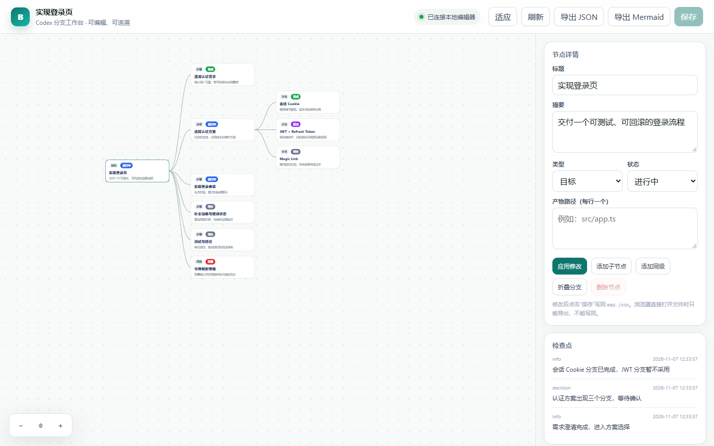
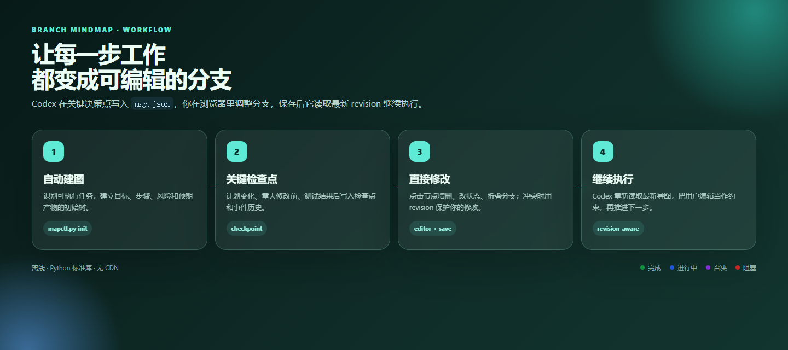
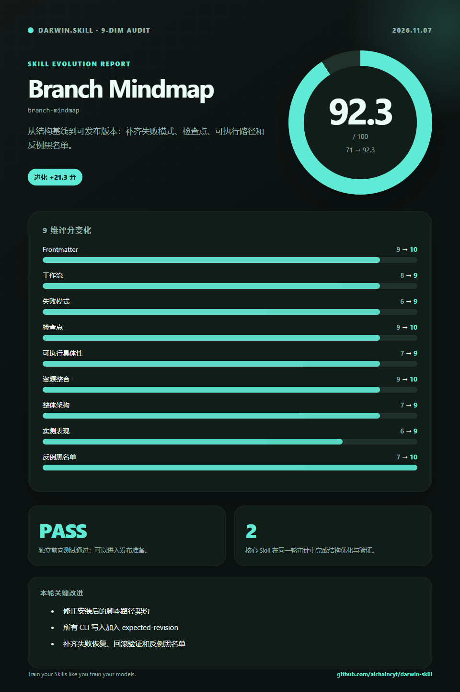

# Branch Mindmap

> 让 Codex 的每一步工作变成一张看得见、改得动、留得下的分支思维导图。

`branch-mindmap` 是一个 Codex Skill + 本地可视化工作台。它会在可执行任务的关键决策点维护 `.codex-mindmap/<task-id>/map.json`，并生成可离线打开的 HTML 树图。你可以直接增删节点、修改状态、折叠分支，保存后让 Codex 继续执行。

## Preview





## English Summary

A Codex skill and local editor for branch-based task execution. Every actionable task gets an editable mind map with stable node IDs, revision-aware saving, checkpoints, artifact links, Mermaid export, and a browser UI that works offline.

## 核心能力

- 自动为文件修改、调查、设计、编码、测试和多步决策任务建图。
- 纯知识问答不建图，避免无意义文件。
- 树状布局、缩放、平移、折叠分支。
- 点击节点修改标题、摘要、类型、状态和产物。
- 新增子节点/同级节点，删除子树。
- 保存到 `map.json`，增量写入 `events.jsonl`。
- 导出 JSON 和 Mermaid。
- 通过 `revision` 和 `expected_revision` 检测并发保存冲突。
- 完全离线，仅依赖 Python 标准库。

## 安装

### 方式一：skills CLI

```bash
npx skills add youmeng96/branch-mindmap -a codex
```

### 方式二：手动安装

```bash
git clone https://github.com/youmeng96/youmeng96/branch-mindmap.git ~/.codex/skills/branch-mindmap
```

Windows PowerShell：

```powershell
git clone https://github.com/youmeng96/youmeng96/branch-mindmap.git "$HOME\.codex\skills\branch-mindmap"
```

安装后重新打开 Codex 任务，让 Skill 被重新扫描。

## 快速开始

在 Codex 中说：

```text
Use $branch-mindmap to map this task and keep branches visible at decision checkpoints.
```

或者直接让 Codex 做一个多步骤任务。Skill 会自动初始化：

```text
.codex-mindmap/<task-id>/
├── map.json
├── events.jsonl
├── mindmap.html
└── mindmap.md
```

安装后不要把 Codex 的工作目录误当成 Skill 目录。先定位脚本：

```bash
MAPCTL="$HOME/.codex/skills/branch-mindmap/scripts/mapctl.py"
python "$MAPCTL" init --workspace . --task "实现登录页" --goal "完成可测试的登录流程"
```

Windows PowerShell：

```powershell
$MAPCTL = "$HOME\.codex\skills\branch-mindmap\scripts\mapctl.py"
python $MAPCTL init --workspace . --task "实现登录页" --goal "完成可测试的登录流程"
```

## 打开可编辑导图

```bash
python "$MAPCTL" serve --map .codex-mindmap/<task-id>/map.json
```

命令会返回一个带临时令牌的 `127.0.0.1` 地址，并尝试打开浏览器。页面通过本地 API 读取和保存 `map.json`，不会把数据发送到外部服务。

如果直接双击 `mindmap.html`：

- 可以看到嵌入的任务图。
- 可以在内存中编辑并导出 JSON/Mermaid。
- 不能写回 `map.json`。

## CLI

```bash
python "$MAPCTL" init --workspace . --task "任务名" --goal "目标"
python "$MAPCTL" status --map <map.json>
python "$MAPCTL" add --map <map.json> --expected-revision <revision> --parent n-0001 --title "新步骤" --kind step
python "$MAPCTL" update --map <map.json> --expected-revision <revision> --node n-0002 --status done
python "$MAPCTL" checkpoint --map <map.json> --expected-revision <revision> --message "测试通过" --status info
python "$MAPCTL" render --map <map.json>
python "$MAPCTL" validate --map <map.json>
python "$MAPCTL" serve --map <map.json>
```

`add`、`update` 和 `checkpoint` 都需要当前 revision。revision 不一致时命令失败，必须先读取最新文件再合并。CLI 与本地编辑器共享跨进程锁；更新用户编辑过的节点需要先确认，再显式传 `--allow-editor-overwrite`。

节点类型：`goal`、`step`、`decision`、`branch`、`artifact`、`risk`。

节点状态：`todo`、`active`、`done`、`blocked`、`rejected`。

## 更新节奏

Codex 只在关键检查点更新导图：

1. 任务初始化。
2. 初始计划形成。
3. 出现新的方案分叉。
4. 执行重大修改或不可逆操作前。
5. 测试、构建、调研得到新结果。
6. 用户手动编辑后。
7. 任务完成时。

需要用户选择的分支会标记为 `decision`，Codex 必须等待用户确认，不能擅自选择。

## 冲突处理

- 浏览器保存时发送 `expected_revision`。
- 服务端 revision 已变化时返回 `409 Conflict`。
- CLI 写入必须携带 `--expected-revision`。
- CLI 与服务共享跨进程锁，避免并发覆盖。
- 浏览器不会自动覆盖，需要刷新并合并。
- Codex 写图前重新读取最新 `map.json`。
- 用户修改的节点保留 `origin: "editor"`；Codex 更新前必须显式确认。

## 验证

```bash
python "$MAPCTL" validate --map <map.json>
python -m unittest discover -s tests -v
```

测试覆盖：

- 初始化、添加、更新和检查点。
- Mermaid/HTML 渲染。
- 非法父节点和环检测。
- 本地服务令牌。
- CLI 与浏览器写入的 revision 冲突。

## 仓库结构

```text
branch-mindmap/
├── SKILL.md
├── agents/openai.yaml
├── references/
│   ├── map-schema.md
│   └── workflow.md
├── assets/
│   ├── map_editor.html
│   ├── icon-small.svg
│   ├── icon-large.svg
│   ├── editor-preview.png
│   ├── darwin-score.png
│   └── workflow-preview.png
├── scripts/mapctl.py
├── tests/test_mapctl.py
├── test-prompts.json
├── README.md
├── CHANGELOG.md
└── LICENSE
```

## 设计边界

- v0.1 不做拖拽排序和多人实时协作。
- Skill 依靠 Codex 在检查点主动写图，不是运行时 hook。
- 导图是工作记录，不替代测试结果。
- 不自动把 `.codex-mindmap/` 提交到 Git。

## 方法来源

结构基线为 OpenAI bundled `skill-creator`。交互设计参考了“先让用户看见分支，再让用户改变分支”的工作流原则；方法论归属见 [`references/map-schema.md`](references/map-schema.md) 与仓库许可证。

## License

[MIT](LICENSE)

## Quality Gate



发布前使用 Darwin 9 维 rubric 做结构审计与独立前向测试，重点检查失败模式、检查点、可执行具体性、路径契约和反例黑名单。当前审计为 92.3/100，独立测试结论为 PASS。
